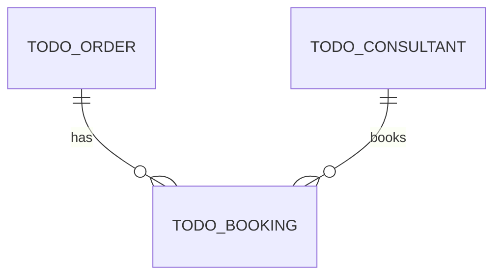

# Domain model

> See [guide 2.3](guide.md#23-model-the-domain). Replace every `TODO`.

## Glossary

| Term | Meaning |
|---|---|
| TODO | TODO |

## Entity relationship diagram

Entities we **build now** are marked `(now)`, entities of the **next expansion stage** `(later)`.

## Notes

TODO – anything the diagram does not show, for example how the remaining budget is calculated.
