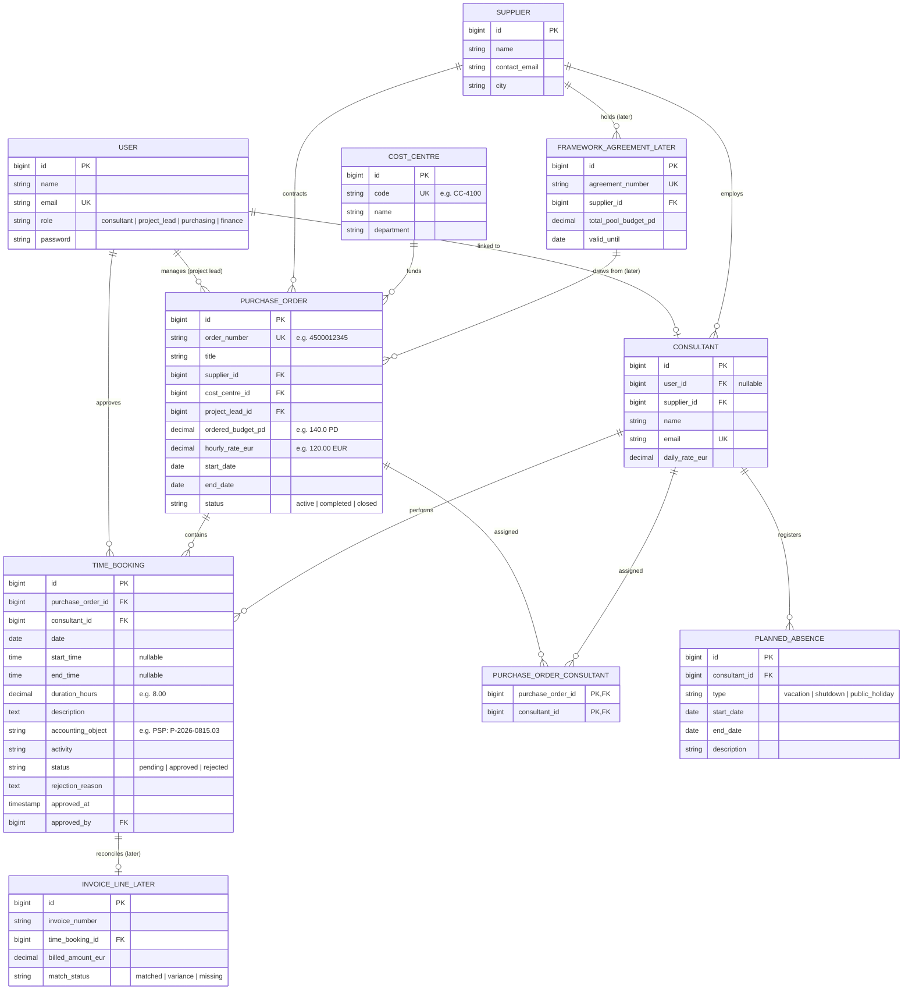

# Domain Model & Entity Architecture

This document describes the domain terminology, core entity relations, and architecture of **Pegel**.

## Glossary

| Term | German | Meaning |
|---|---|---|
| **Purchase Order** | *Bestellung* | The client's formal contract to a supplier with a defined scope, period, and budget. Every booking belongs to exactly one order. |
| **Person-Day (PD)** | *Personentag (PT)* | Standard industry unit: 1 person working 1 full day (standardized as 8.0 hours). Day rates and order budgets are counted in PD. |
| **Framework Agreement** | *Rahmenvertrag* | A master contract with a supplier defining general conditions and a global umbrella budget from which individual purchase orders draw. *(Expansion stage)* |
| **Cost Centre / PSP Element** | *Kostenstelle / PSP-Element* | Client internal accounting objects that decide which department or project budget pays for external consultant hours. |
| **Proof of Work** | *Leistungsnachweis* | Verified itemized list of hours worked by a supplier during a billing period (e.g., month), approved by the client Project Lead before invoice settlement. |
| **Working Time Act** | *Arbeitszeitgesetz (ArbZG)* | German federal labor law mandating a maximum 10-hour working day (§ 3) and an 11-hour mandatory uninterrupted rest period between shifts (§ 5). |
| **Planned Absence** | *Geplante Abwesenheit* | Planned vacations, client site shutdowns (e.g. Christmas/New Year), or public holidays that impact consultant availability and shift budget burn-out dates. |
| **Calendar Week (KW)** | *Kalenderwoche (KW)* | Standard German business planning cadence (KW 1 to KW 52/53). Budget forecasts and purchasing lead-time re-order alerts are pinned to calendar weeks. |

---

## Entity Relationship Diagram

Entities marked **`(now)`** are implemented with server-side database tables, foreign keys, and unit tests in the current release. Entities marked **`(later)`** represent the next expansion stage.

---

## Core Budget & Forecast Formulas

1. **Total Ordered Hours:**
   $$\text{orderedHours} = \text{orderedBudgetPD} \times 8.0$$

2. **Total Used Hours & PD:**
   $$\text{usedHours} = \sum_{\text{status} \neq \text{'rejected'}} \text{durationHours}$$
   $$\text{usedPD} = \frac{\text{usedHours}}{8.0}$$

3. **Remaining Free Budget:**
   $$\text{remainingBudgetHours} = \max(0, \text{orderedHours} - \text{usedHours})$$
   $$\text{remainingBudgetPD} = \frac{\text{remainingBudgetHours}}{8.0}$$

4. **Predictive Depletion Week:**
   Calculated by projecting weekly consultant velocity (e.g., 6 PD / week) minus planned absence blocks and client plant shutdowns into the project timeline.
